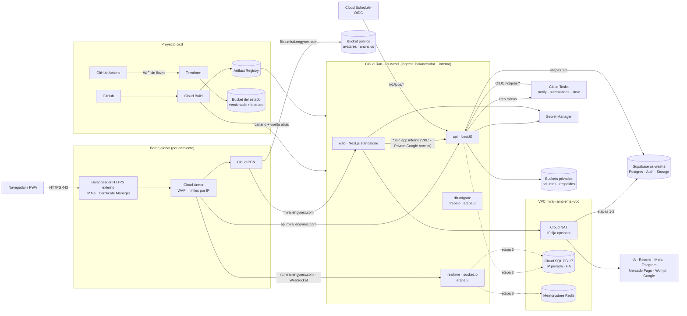

# Mirai en GCP: estrategia de infraestructura como código (fase 3)

> Escrito el 2026-11-02 en la rama `v6`. Base: `docs/arquitectura/v6-separacion-front-back.md` (doc v6), `docs/DEPLOY-VERCEL.md`, `docs/PWA.md` y `apps/web/vercel.json`.
> Código: `infra/terraform/` (módulos, `stack/` y raíces por ambiente), `infra/cloudbuild/` (pipelines) e `infra/docker/web.Dockerfile`. Operación: `docs/infra/runbook.md`.
> No se creó nada en la nube: no hay credenciales. Terraform pasa `fmt`, `validate` en las tres raíces y `terraform test` con proveedores simulados (§16). La imagen web se compiló y arrancó en local.
> **Alineado con la API el 2026-11-02** (F2-B/C/E/G/I): variables con los nombres reales del esquema zod (§5), colas con ids literales, Scheduler solo con el tick y el drain (§7, etapa 2), gateway `mirai-realtime` (§5) y URI de Google `<API_PUBLIC_URL>/v1/google/callback` (§14).
> **Los costos son estimados** (precios de lista de us-west1 a la fecha, sin descuentos ni impuestos) y hay que confirmarlos con la calculadora de Google antes de la fase 4.

---

## 0. Resumen

| Tema | Decisión |
|---|---|
| Proyectos | Tres: `cicd` (estado de Terraform, Artifact Registry, Cloud Build, WIF), `pruebas` y `produccion`. Un problema o un permiso de más en pruebas no toca producción |
| Región | **`us-west1` (Oregón)** en todas las etapas mientras la base siga en Supabase `us-west-2`. Después del corte a Cloud SQL se puede evaluar mover todo a `us-east1` (§3) |
| Cómputo | Cloud Run v2: `web` (Next.js standalone), `api` (NestJS) y `realtime` (socket.io, etapa 3) |
| Entrada | Balanceador HTTPS externo global + certificado de Certificate Manager con autorización DNS + Cloud Armor (WAF y límites) + Cloud CDN para la web y los archivos públicos. Cloud Run solo acepta tráfico del balanceador y tráfico interno |
| Red | VPC propia, **Direct VPC egress** (sin conector), Private Google Access, Private Services Access para Cloud SQL y Memorystore, Cloud NAT con IP fijas opcionales |
| Datos | Cloud Storage (3 buckets por ambiente), Cloud SQL PostgreSQL 17 (etapa 3: **HA regional en producción**, zonal en pruebas), Memorystore Redis Basic 1 GB (**solo producción**, etapa 3) |
| Cron y colas | Cloud Scheduler (2 trabajos con OIDC: `notify/tick` cada hora y `automations/drain` cada 5 min; el tick encola las diarias) + Cloud Tasks (colas con los ids literales que usa la API: `notify`, `automations`, `slow`) |
| Identidad | Identity Platform preparado (etapa 4): correo con contraseña o enlace, Google y TOTP |
| Secretos | Secret Manager, un secreto por variable; Terraform crea el contenedor y los permisos, **los valores se cargan aparte** |
| CI/CD | Cloud Build con disparadores por rama (`pruebas` → pruebas, `main` → producción con aprobación), `turbo prune` + Docker, pruebas, escaneo de vulnerabilidades y canario 10 % → 50 % → 100 % con vuelta atrás automática |
| Acceso sin llaves | Cuentas de servicio por servicio, Workload Identity Federation para GitHub Actions, sin archivos JSON |
| Observabilidad | Alertas de 5xx, latencia, disponibilidad, Cloud SQL, Redis, colas, fallas del cron y errores en registros; Error Reporting; presupuesto por proyecto |

---

## 1. Arquitectura destino



**Recorrido de una petición (etapa 1):** el navegador entra por el balanceador, Cloud Armor revisa WAF y límites, la web responde (estáticos desde Cloud CDN), y el servidor de Next llama a la API por la URL interna `*.run.app`. La API y la web siguen leyendo Supabase. Los webhooks de pagos llegan por `api…/v1/webhooks/*` (exentos del WAF, con límite por IP; la firma la valida la API).

---

## 2. Proyectos y ambientes

| | `cicd` | `pruebas` | `produccion` |
|---|---|---|---|
| ID sugerido | `engynex-mirai-cicd` | `engynex-mirai-pruebas` | `engynex-mirai-prod` |
| Contiene | Bucket del estado, Artifact Registry `mirai`, conexión GitHub ↔ Cloud Build, disparadores, cuentas de despliegue, WIF | Todo el ambiente de pruebas | Todo el ambiente de producción |
| Rama | — | `pruebas` | `main` (con aprobación manual en Cloud Build) |
| Web | — | `pruebas.mirai.engynex.com` | `mirai.engynex.com` |
| Otros dominios | — | `api.`, `rt.`, `files.`, `canary.` y `canary-api.` + `pruebas.mirai.engynex.com` | `api.`, `rt.`, `files.`, `canary.` y `canary-api.` + `mirai.engynex.com` |
| Certificado | — | `pruebas.mirai.engynex.com` + `*.pruebas.mirai.engynex.com` | `mirai.engynex.com` + `*.mirai.engynex.com` |
| Raíz de Terraform | `envs/bootstrap` | `envs/pruebas` | `envs/produccion` |

- Nombres: `mirai-<ambiente>-<recurso>` (p. ej. `mirai-produccion-api`, `mirai-pruebas-armor`, `mirai-produccion-pg`). Etiquetas en todo: `app=mirai`, `ambiente`, `gestionado-por=terraform`, `servicio`/`proposito`.
- Las dos raíces de ambiente llaman al mismo `stack/` con tamaños distintos (pruebas escala a cero y no tiene HA; producción tiene 1 instancia mínima, HA y canario más largo). Así no se copian 600 líneas entre ambientes.
- **Ojo, base compartida:** hoy pruebas y producción usan la misma base de Supabase (`docs/DEPLOY-VERCEL.md`). Por eso el cron de pruebas queda **en pausa** (`stages.scheduler_paused = true`): si no, los avisos saldrían dos veces. Cuando se separe la base de pruebas, se enciende.
- La "etapa" de cada ambiente se controla con `stages` en su `terraform.tfvars` (§7): cada etapa enciende solo lo que necesita y no se paga Cloud SQL ni Redis antes de tiempo.

---

## 3. Región

**Decisión: `us-west1` (Oregón).**

| Región | Latencia estimada desde Bogotá (ida y vuelta) | Latencia a Supabase us-west-2 | Precio relativo |
|---|---|---|---|
| **us-west1** (Oregón) | ~110–130 ms | **~5–10 ms** (misma zona metropolitana que AWS us-west-2) | 1,0 (nivel 1) |
| us-central1 (Iowa) | ~75–95 ms | ~35–45 ms | 1,0 |
| us-east1 (Carolina del Sur) | ~55–70 ms | ~60–70 ms | 1,0 |
| southamerica-east1 (São Paulo) | ~95–130 ms (la ruta desde Colombia suele pasar por Miami) | ~170 ms | ~1,3–1,5 |

*Latencias aproximadas de mediciones públicas; hay que medirlas desde Colombia (p. ej. gcping.com) antes de cualquier cambio. No hay región de GCP en Colombia.*

Por qué:
1. **Lo que manda es la latencia API → base, no navegador → API.** Una pantalla de Mirai hace varias consultas por petición (`mirai_app_context`, PostgREST, RPC). Con la API en us-east1 y la base en us-west-2, cada consulta sumaría ~65 ms: una página con 5 consultas en serie empeoraría ~300 ms. En us-west1 cada consulta cuesta ~5–10 ms, igual que hoy con Vercel en `pdx1` (`apps/web/vercel.json`).
2. El doc v6 (§4.1, D4) ya eligió `us-west1` por la misma razón.
3. Nivel 1 de precios (el más barato) y tiene todo: Cloud Run con Direct VPC egress, Cloud SQL Enterprise Plus, Memorystore, Cloud Tasks y Scheduler.
4. Los estáticos (`/_next/static`, avatares) salen de Cloud CDN, que está en el borde más cercano a la persona (Bogotá/Miami), así que la región pesa poco para ellos.

**Revisión en la etapa 3.** Cuando la base sea Cloud SQL (y Supabase quede apagada) desaparece la razón de estar en Oregón. Mover todo a `us-east1` ahorraría ~50 ms por petición desde Colombia. Se puede hacer en el mismo corte de la etapa 3 (crear Cloud SQL directamente en `us-east1` y redesplegar los servicios, que no tienen estado) o en una etapa 3b. `region` es una sola variable (también da `GCP_LOCATION` a la API); lo que cambia de verdad es: Cloud SQL (réplica entre regiones y promoción), buckets (copia), Artifact Registry (repositorio nuevo) y las colas (se crean en la región nueva con los mismos ids; vaciar las viejas antes). Recomendación: decidir con mediciones reales de p95 después de 2 semanas en Cloud SQL.

---

## 4. Red

- **VPC** `mirai-<ambiente>-vpc`, modo personalizado, subred `mirai-<ambiente>-run` (`10.10.0.0/24` pruebas, `10.20.0.0/24` producción) con **Private Google Access**. Regla explícita que niega toda entrada (con registro).
- **Direct VPC egress** en vez del Serverless VPC Access connector: no hay VMs del conector que pagar (~USD 15–20/mes cada una) ni que escalar, menos latencia y escala con las instancias. La subred /24 alcanza para ~120 instancias (cada una usa unas 2 IP).
- **Salida de cada servicio:**
  - `web` → `ALL_TRAFFIC`: llama a la API por su URL `*.run.app` y, al salir por la VPC con Private Google Access, la petición cuenta como **interna** (la API tiene ingress "solo balanceador e interno"). El resto (Supabase, IA) sale por Cloud NAT.
  - `api`, `realtime` → `PRIVATE_RANGES_ONLY`: solo Cloud SQL y Redis van por la VPC; internet sale directo desde Cloud Run. Si una integración exige lista blanca de IP (p. ej. una pasarela o un banco), se pone `services.api.vpc_egress = "ALL_TRAFFIC"` y `nat_static_ip_count = 1`: la IP sale en la salida `nat_ips`.
- **Private Services Access** (rango /20 reservado + peering con `servicenetworking`) para Cloud SQL con IP privada y Memorystore. Se crea solo cuando `cloud_sql` o `redis` están encendidos. Se eligió PSA y no Private Service Connect porque sirve para ambos servicios con un solo rango y es lo que esperan el Cloud SQL Node.js Connector y Memorystore Basic; PSC para Cloud SQL queda como opción si algún día hace falta conectar otro proyecto.
- **Cloud NAT** con IP automáticas (o fijas), asignación dinámica de puertos (64–4096 por instancia) y registro de errores.
- **Ingress de Cloud Run:** `INGRESS_TRAFFIC_INTERNAL_LOAD_BALANCER` en web, api y realtime. Así nadie salta Cloud Armor entrando por `*.run.app`. Cloud Scheduler y Cloud Tasks del mismo proyecto cuentan como tráfico interno.
- **Invocación pública sin `allUsers`:** los servicios usan `invoker_iam_disabled = true`, compatible con la política de organización "Domain restricted sharing" que Google activa por defecto en las organizaciones nuevas. La autenticación la hace la app (JWT de Supabase y, para `/v1/jobs/*`, el token OIDC de Scheduler/Tasks que valida `SchedulerGuard`).

---

## 5. Servicios de Cloud Run

| | web | api | realtime (etapa 3) |
|---|---|---|---|
| Imagen | `infra/docker/web.Dockerfile` (standalone, Node 26, usuario sin privilegios) | `apps/api/Dockerfile` (F2-B) | la misma de la API con `MODE=realtime` |
| CPU / memoria | 1 vCPU / 1 GiB | 1 vCPU / 1 GiB | 1 vCPU / 512 MiB |
| Instancias pruebas | 0–3 | 0–3 | 0–1 (sin Redis) |
| Instancias producción | 1–20 | 1–20 | 1–6 |
| Concurrencia | 80 | 80 | 250 |
| Tiempo máximo | 300 s (`/api/chat` sigue en la web) | 300 s (chat NDJSON) | 3600 s (WebSocket) |
| CPU | solo en peticiones | solo en peticiones | **siempre asignada** en producción (escucha `pg_notify` y Redis) |
| Afinidad de sesión | no | no | **sí** (socket.io con long-polling) |
| Arranque y vida | sonda TCP + `startup_cpu_boost` | sonda TCP + vida en `/healthz` | sonda HTTP `/healthz` + vida en `/healthz` |
| Red | `ALL_TRAFFIC` (llama a la API por la VPC) | `PRIVATE_RANGES_ONLY` | **Direct VPC egress** `PRIVATE_RANGES_ONLY` → Memorystore (y Cloud SQL) |
| Dominio | `<dominio>` y `canary.` | `api.` y `canary-api.` | `rt.` (solo con `stages.realtime`) |

Terraform es dueño de la configuración (cuenta, escala, red, variables, secretos); **Cloud Build es dueño de la imagen y del tráfico**. El módulo ignora `image`, `revision` y `traffic`, así un `terraform apply` nunca revierte un despliegue. Un cambio de configuración crea una revisión nueva que recibe el 100 % porque el tráfico queda en "la más reciente" después de cada despliegue (runbook §4.3).

Terraform no pone `PORT` (Cloud Run inyecta 8080) y Cloud Build nunca cambia variables: `gcloud run deploy --image` conserva las de la revisión anterior (un `--set-env-vars` en el pipeline lo revertiría el siguiente `apply`).

### 5.1 Variables de cada servicio (origen y valor)

Nombres = los que validan `apps/api/src/core/config/config.schema.ts` (núcleo), `modules/integrations/services-env.ts` (F2-E), `modules/billing/billing.config.ts` y `modules/households/site-url.ts` (F2-I) y `modules/realtime/realtime.config.ts` (F2-G). **V** = variable normal (`stack/services.tf`), **S** = Secret Manager (`stack/secrets.tf`, §6). Extras sin tocar el stack: `api_env` y `realtime_env` (pisan los valores del stack).

**api** (`mirai-<amb>-api`, `MODE=api`):

| Variable | Origen | Valor | Lo lee |
|---|---|---|---|
| `MODE` | V | `api` | núcleo |
| `MIRAI_ENV` | V | `pruebas` / `produccion` | núcleo, F2-E |
| `NODE_ENV`, `LOG_LEVEL` | V | `production`; `debug` en pruebas, `info` en producción | Node, núcleo |
| `SUPABASE_URL`, `SUPABASE_PUBLISHABLE_KEY` | V | de `public_config` (`NEXT_PUBLIC_SUPABASE_*`) | núcleo |
| `WEB_ORIGINS` | V | `https://<web>`, `https://canary.<web>` + `extra_web_origins` (p. ej. Vercel en la transición) | núcleo (CORS) |
| `DB_ADAPTER` | V | `db_adapter` (`supabase` hasta el corte; `pg` exige el secreto `database-url`) | núcleo |
| `QUEUE_DRIVER` | V | `cloudtasks` | núcleo |
| `GCP_PROJECT`, `GCP_LOCATION` | V | proyecto del ambiente y `region` | núcleo (Cloud Tasks) |
| `TASKS_SERVICE_ACCOUNT` | V | `mirai-<amb>-tasks@…` (la API hace `actAs`) | núcleo |
| `API_BASE_URL` | V | `https://mirai-<amb>-api-<número>.<región>.run.app` (URL interna determinista) | núcleo: URL de vuelta y audiencia del token de cada tarea |
| `SCHEDULER_AUDIENCE` | V | la misma URL `*.run.app` (= audiencia de Scheduler y de las colas) | núcleo (`SchedulerGuard`) |
| `SCHEDULER_SERVICE_ACCOUNTS` | V | `mirai-<amb>-scheduler@…`, `mirai-<amb>-tasks@…` | núcleo (`SchedulerGuard`) |
| `TICK_DAILY_TASKS` | V | `1` (el tick encola las diarias; §7 etapa 2) | F2-E |
| `AUTOMATIONS_OUTBOX` | V | `1` | F2-E |
| `SITE_URL` | V | `https://<web>` | F2-E (correos, regreso de Google), F2-I (invitaciones, retorno de pagos) |
| `API_PUBLIC_URL` | V | `https://api.<dominio>` → callback `<API_PUBLIC_URL>/v1/google/callback` | F2-E |
| `GOOGLE_CLIENT_ID`, `VAPID_PUBLIC_KEY`, `VAPID_SUBJECT` | V | de `public_config` (`GOOGLE_CLIENT_ID`, `NEXT_PUBLIC_VAPID_PUBLIC_KEY`, `VAPID_SUBJECT`); si están vacíos no se mandan | F2-E |
| `WOMPI_PUBLIC_KEY` | V | de `public_config` (`NEXT_PUBLIC_WOMPI_PUBLIC_KEY`) | F2-I |
| `REALTIME_API_EMIT` | V | `1` solo con `stages.redis` | F2-G (publica en Redis para el gateway) |
| `GIT_BRANCH` | V | `pruebas` / `main` (de `cicd.branch_regex`) | consola › Sistema |
| `STORAGE_BUCKET_PRIVATE\|PUBLIC\|BACKUPS`, `PUBLIC_FILES_URL` | V | buckets y `https://files.<dominio>` (con `stages.storage`) | `FilesModule` (F2-D): **aún no los lee** |
| `SUPABASE_SECRET_KEY`, `ENCRYPTION_KEY`, `CRON_SECRET` | S (siempre) | §6 | núcleo |
| `GOOGLE_CLIENT_SECRET`, `GOOGLE_OAUTH_STATE_KEY`, `VAPID_PRIVATE_KEY`, `AI_GATEWAY_API_KEY` | S (opcionales) | §6 | F2-E |
| `MERCADOPAGO_ACCESS_TOKEN`, `MERCADOPAGO_WEBHOOK_SECRET`, `WOMPI_INTEGRITY_SECRET`, `WOMPI_EVENTS_SECRET` | S (opcionales) | §6 | F2-I |
| `SUPABASE_JWT_SECRET`, `DATABASE_URL` | S (opcionales) | §6 | núcleo |
| `REDIS_URL` | S (etapa 3, lo genera Terraform) | `redis://:<AUTH>@<IP>:6379` | F2-G |

Se dejan con su valor por defecto (cámbialos con `api_env`): `HOST`, `AUTH_JWKS_URL`/`AUTH_ISSUER`/`AUTH_AUDIENCE` (salen de `SUPABASE_URL`), `RATE_LIMIT_STORE` (`supabase` fuera de local), `RATE_LIMIT_DEFAULT_PER_MIN`, `IDEMPOTENCY_STORE` (`memory`; `supabase` cuando la migración `api_idempotency` esté aplicada), `DOCS` (siempre apagado en producción), `VALIDATE_RESPONSES`, `APP_VERSION`, `GIT_COMMIT` (sale de `K_REVISION`) y `OTEL_*` (OpenTelemetry apagado si no hay exportador).

**realtime** (`mirai-<amb>-realtime`, misma imagen con `MODE=realtime`, etapa 3): `MODE=realtime`, `MIRAI_ENV`, `NODE_ENV`, `LOG_LEVEL`, `SUPABASE_URL`, `SUPABASE_PUBLISHABLE_KEY`, `WEB_ORIGINS` (el gateway revisa el origen del *handshake* y del *upgrade*), `DB_ADAPTER`, `GIT_BRANCH` (V) + `realtime_env` para `REALTIME_PATH`, `REALTIME_TOKEN_CHECK_S`, `REALTIME_PRESENCE_TTL_S`, `REALTIME_RECOVERY_S`, `REALTIME_MAX_BOOKS`, `REALTIME_EVENTS_PER_10S` y `REALTIME_PG_LISTEN` (fase 4). Secretos: `SUPABASE_SECRET_KEY` y `ENCRYPTION_KEY` (los exige el núcleo fuera de local y `/readyz`), `REDIS_URL` (con Redis), `DATABASE_URL` y `SUPABASE_JWT_SECRET` (opcionales). **No** lleva cron ni colas: el esquema ya no exige `SCHEDULER_*`/`CRON_SECRET` con `MODE=realtime` (prueba en `config.schema.test.ts`). `REALTIME_DATABASE_URL` no hace falta: con Cloud SQL, `DATABASE_URL` ya es una conexión directa de sesión.

**web**: `public_config` completo, `NEXT_PUBLIC_SITE_URL`, `NEXT_PUBLIC_API_URL`, `NEXT_PUBLIC_LIVE_SOURCE` (`live_source`: `supabase` hoy, `gateway` en la fase 4 y solo con `stages.realtime`), `NEXT_PUBLIC_REALTIME_URL` (`https://rt.<dominio>`, solo con `stages.realtime`), `API_INTERNAL_URL`, `MIRAI_ENV`, `HOSTNAME`, `NEXT_TELEMETRY_DISABLED` (V; los `NEXT_PUBLIC_*` también se incrustan en el build con `_WEB_BUILD_ENV_B64`) y sus secretos (§6).

### 5.2 Gateway `mirai-realtime`

- Cloud Run con **afinidad de sesión** (long-polling de socket.io), **timeout 3600 s** (Cloud Run corta el WebSocket a la hora y el cliente reconecta solo), **concurrencia 250**, **mínimo 1 instancia** y CPU siempre asignada en producción (en pruebas 0–1 instancias y CPU por petición, para no pagar ~USD 45/mes; para un ensayo real del gateway sube a `min_instances = 1` y `cpu_always_on = true`).
- **Direct VPC egress** `PRIVATE_RANGES_ONLY` en la subred del ambiente: llega a Memorystore (producción, `stages.redis`) y a Cloud SQL por Private Services Access; internet sale directo.
- Sondas en `/healthz` (no toca la base ni Redis). Chequeo de disponibilidad de `https://rt.<dominio>/healthz` con `uptime_checks`.
- Entrada: `rt.<dominio>` en el balanceador (backend `realtime`, el certificado comodín ya lo cubre; el registro A sale en `dns_records`). Ingress solo balanceador + interno.
- CSP de la web: `connect-src` ya incluye `https:` y `wss:` (`apps/web/lib/security/headers.ts`), así que `rt.` no necesita cambio. El origen permitido lo da `WEB_ORIGINS`.
- Varias instancias exigen Redis (validación de `stages`); sin Redis, una sola instancia con adaptador en memoria.
- La web solo lo usa con `live_source = "gateway"` (fase 4, con `mirai_live_notify` instalado en Cloud SQL y `REALTIME_PG_LISTEN=1`).

---

## 6. Secretos

Inventario sacado de `.env.example`, `apps/web/lib/env.ts`, todo `process.env.*` de `apps/` y `packages/`, el registro de integraciones (`env:` de `ai_gateway`, `webpush`, `google_*`) y el doc v6 §2.7.9. Catálogo en `infra/terraform/stack/secrets.tf`.

| Variable | Secreto (`mirai-<amb>-…`) | Lo montan | Obligatorio | De dónde sale el valor |
|---|---|---|---|---|
| `SUPABASE_SECRET_KEY` | `supabase-secret-key` | web, api, realtime | sí | Supabase › Project Settings › API keys |
| `ENCRYPTION_KEY` | `encryption-key` | web, api, realtime | sí | **Copia exacta** de la de Vercel. No se cambia nunca: cifra las integraciones guardadas en la base. realtime no descifra nada, pero el núcleo y `/readyz` la exigen fuera de local |
| `CRON_SECRET` | `cron-secret` | web, api | sí | El de Vercel (es el mismo que tiene el job `mirai-notify` de pg_cron). En la API es el respaldo de `SchedulerGuard`; lo principal es OIDC |
| `GOOGLE_CLIENT_SECRET` | `google-client-secret` | web, api | no | Google Cloud › Credenciales (cliente OAuth actual) |
| `GOOGLE_OAUTH_STATE_KEY` | `google-oauth-state-key` | api | no (sin él no se conecta Gmail/Calendar desde la API) | Nuevo, 32+ caracteres: `openssl rand -base64 32` (runbook §2.3) |
| `AI_GATEWAY_API_KEY` | `ai-gateway-api-key` | web, api | no | Vercel › AI Gateway (respaldo si no hay fila global) |
| `VAPID_PRIVATE_KEY` | `vapid-private-key` | web, api | no | La pareja actual (si se cambia, se pierden las suscripciones push) |
| `UPSTASH_REDIS_REST_TOKEN` | `upstash-redis-rest-token` | web | no | Upstash (la API no lo lee) |
| `MERCADOPAGO_ACCESS_TOKEN` | `mercadopago-access-token` | web, api | no | Mercado Pago (prueba en pruebas, producción en producción) |
| `MERCADOPAGO_WEBHOOK_SECRET` | `mercadopago-webhook-secret` | web, api | no (en producción la API no procesa webhooks sin él) | Mercado Pago › Webhooks |
| `WOMPI_INTEGRITY_SECRET` | `wompi-integrity-secret` | web, api | no | Wompi › Desarrolladores |
| `WOMPI_EVENTS_SECRET` | `wompi-events-secret` | web, api | no | Wompi › Desarrolladores |
| `SUPABASE_JWT_SECRET` | `supabase-jwt-secret` | api, realtime | no | Solo si Supabase sigue firmando con HS256 |
| `DATABASE_URL` | `database-url` | api, realtime | no (sí con `db_adapter = "pg"`: una validación lo exige) | Fase 4: conexión directa a Cloud SQL por IP privada (la API usa `pg` con `DATABASE_URL`, no el conector IAM: hace falta un usuario con contraseña o agregar el conector en `PgKyselyFactory`) |
| `SUPABASE_DB_URL` | `supabase-db-url` | ninguno (solo la cuenta `migrator`) | no | Para migraciones, volcados y DMS |
| `REDIS_URL` | `redis-url` | api, realtime | sí (etapa 3) | Lo genera Terraform desde Memorystore: `redis://:<AUTH>@<IP>:6379` (TLS: §10) |

**No son variables y no van a Secret Manager:** las claves de Resend, Brevo, SendGrid, SMTP, Gmail, WhatsApp/Meta, Telegram, proveedores de IA del hogar, AdSense, Turnstile, Sentry, etc. Desde la v5.5 viven **cifradas con `ENCRYPTION_KEY`** en `platform_integrations`/`integrations` y se configuran en consola › Integraciones globales. Migrarlas a GCP es copiar la base (etapa 3) y mantener la misma `ENCRYPTION_KEY`.

**Configuración pública** (`public_config` en `terraform.tfvars`, va al build y a las variables normales): `NEXT_PUBLIC_SUPABASE_URL`, `NEXT_PUBLIC_SUPABASE_PUBLISHABLE_KEY`, `NEXT_PUBLIC_LEGAL_OWNER|NIT|EMAIL|CITY`, `GOOGLE_CLIENT_ID`, `NEXT_PUBLIC_VAPID_PUBLIC_KEY`, `VAPID_SUBJECT`, `NEXT_PUBLIC_TURNSTILE_SITE_KEY`, `UPSTASH_REDIS_REST_URL`, `NEXT_PUBLIC_SENTRY_DSN`, `NEXT_PUBLIC_WOMPI_PUBLIC_KEY`, `NEXT_PUBLIC_ADSENSE_CLIENT|SLOT`, `MIRAI_CSP_ENFORCE`. Una validación rechaza claves con `SECRET`, `PASSWORD`, `PRIVATE` o `TOKEN`.

**Cómo se manejan:**
1. Terraform crea el secreto (replicación automática) y da `secretAccessor` **solo** a las cuentas de los servicios que lo usan.
2. La persona dueña carga cada valor con `gcloud secrets versions add … --data-file=-` leyendo de la terminal sin dejar historial (runbook §2.3). Ningún valor pasa por Terraform, por el repositorio ni por un chat.
3. Cloud Run no arranca si un secreto montado no tiene versión. Por eso hay `required` (se montan siempre) y opcionales que se montan solo cuando están en `optional_secrets`.
4. Únicos valores dentro del estado de Terraform: `REDIS_URL` con la clave AUTH de Redis (la genera Memorystore) y el secreto de OAuth de Google cuando se active Identity Platform. El bucket del estado es privado, versionado y solo lo leen las cuentas de Terraform.
5. Rotación: runbook §3 (incluye los casos que **no** se pueden rotar sin más: `ENCRYPTION_KEY` y VAPID).

---

## 7. Plan de migración por etapas

Principios (los del doc v6 y CLAUDE.md): la versión publicada no cambia de comportamiento; cada paso tiene vuelta atrás en minutos; la base compartida solo recibe migraciones aditivas; Vercel y Supabase quedan intactos hasta que cada etapa lleve 2 semanas estable.

### Etapa 0 · Preparación (1 semana)
- Bootstrap (`envs/bootstrap`), conexión GitHub ↔ Cloud Build, `terraform apply` de pruebas y producción con `stages` de la etapa 1, carga de secretos.
- Bajar el TTL de los registros DNS de `mirai.engynex.com` a 300 s en Hostinger **48 h antes** de la etapa 1.
- Crear los CNAME `_acme-challenge` (salida `dns_records`): el certificado se emite **antes** de mover el tráfico.
- Agregar en Supabase › Auth › URL Configuration y en el cliente OAuth de Google las URL nuevas de pruebas (`https://pruebas.mirai.engynex.com/auth/callback`, `/auth/confirm`, `/api/google/callback`) y la de la API: `<API_PUBLIC_URL>/v1/google/callback` = `https://api.pruebas.mirai.engynex.com/v1/google/callback` (y `https://api.mirai.engynex.com/v1/google/callback` en producción).

### Etapa 1 · Web y API en Cloud Run, con Supabase

`stages = { load_balancer = true, storage = true }` (los buckets se crean vacíos; no cuestan casi nada).

1. **Pruebas:** primer despliegue por Cloud Build (push a `pruebas`). Probar en `https://pruebas.mirai.engynex.com` (dominio nuevo, no pisa `engynex-mirai-pruebas.vercel.app`). Correr las E2E de Playwright contra esa URL (`workflow_dispatch` con `base_url`).
2. **Producción en paralelo:** desplegar `main`; mientras el DNS sigue en Vercel, probar con `curl --resolve mirai.engynex.com:443:<IP del balanceador>` y por `canary.mirai.engynex.com`.
3. **Corte:** en Hostinger, cambiar `mirai.engynex.com` de CNAME (Vercel) a A (IP del balanceador) y crear los A de `api`, `files`, `canary` y `canary-api`.

| | |
|---|---|
| Ventana | Martes a jueves, 10:00–11:30 p. m. (hora Colombia), fuera de la hora de los resúmenes (que salen a la hora que elige cada persona, sobre todo 6–9 a. m.) |
| Criterios para cortar | Certificado `ACTIVE`; E2E completas en verde contra pruebas en Cloud Run; humo en `canary.` OK; Cloud Armor en vista previa sin bloqueos que serían falsos positivos en 48 h de pruebas; alertas y presupuesto creados |
| Terminado cuando | 30 min después del corte: 5xx < 0,5 %, p95 de páginas ≤ el de Vercel + 20 %, login, pagos de prueba y push funcionando. 2 semanas estable → Vercel queda solo como respaldo |
| Vuelta atrás | Volver a poner el CNAME de Vercel (TTL 300 s: ~5–10 min). El despliegue de Vercel y sus variables se dejan intactos 4 semanas. **No hay riesgo de datos:** las dos versiones usan la misma base de Supabase |
| Lo que sigue igual | El cron (diario de Vercel + horario de pg_cron, que llama a `https://mirai.engynex.com/api/cron/notify` y por DNS llega a Cloud Run con el mismo `CRON_SECRET`), los webhooks de pagos (`/api/pagos/*` siguen en la web) y Supabase Auth |

### Etapa 2 · Storage y cron/colas en GCP

Depende de que la API (F2-E) tenga `/v1/jobs/*` y `FilesModule`.

**Cron:** Scheduler solo tiene dos trabajos (`stack/jobs.tf`): `mirai-<amb>-notify-tick` (`5 * * * *`) y `mirai-<amb>-automations-drain` (`*/5 * * * *`). El tick hace el latido y encola en Cloud Tasks: una tarea por hogar (`notify`), `plan/emails` y `automations/hourly` cada hora; a las 6 a. m. `refs/refresh`, `calendar/sync` y `net-worth/monthly`, y a las 9 `plan/reminders` (cola `slow`), porque la API corre con `TICK_DAILY_TASKS=1`. Por eso no hay trabajos propios para las diarias (se enviarían dos veces). Si se prefiere un trabajo por diaria: `api_env = { TICK_DAILY_TASKS = "0" }` y se agregan a `scheduler_jobs`. El drain es lo único que el tick no encola. En pruebas todo queda en pausa (`scheduler_paused = true`, base compartida); `scheduler_dry_run = true` manda `{"dry":true}` a los dos trabajos (tareas `dry-…` que calculan y no envían).
1. `scheduler_paused = false` y `scheduler_dry_run = true` en producción: Scheduler llama al tick con `{"dry":true}` y la API calcula sin enviar (doc v6 §4.3 paso 9a). Comparar 3 días con lo que envía el cron actual.
2. Corte: `scheduler_dry_run = false`, `select cron.unschedule('mirai-notify');` y quitar `crons` de `apps/web/vercel.json`.
3. Criterio: cero duplicados (`notification_log` sin claves repetidas en `enviado`) y cero faltantes frente a la simulación. `notify_claim` evita duplicados aunque se crucen.
4. Vuelta atrás: `gcloud scheduler jobs pause …` (o `scheduler_paused = true`) y `select public.mirai_schedule_notify('https://mirai.engynex.com', '<CRON_SECRET>');`.

**Storage:**
1. Copiar los objetos de Supabase Storage (API S3 con `rclone`) a los buckets: `attachments/`, `logos/`, `feedback/` → `private`; `backups/` → `backups`; `avatars/`, `ads/`, `public-assets/` → `public` (detrás de `files.<dominio>` con CDN).
2. Script idempotente que reescribe `profiles.avatar_url`, `family_members.avatar` y las URL de `ads` (doc v6 §5.1).
3. `FilesModule` detrás de `api_rollout`: `admins` → `pct:10` → `on`. Mientras tanto, lo que no esté copiado se sigue leyendo de Supabase.
4. Criterio: mismo número de objetos y mismo MD5 por bucket; E2E de avatares, adjuntos del contador y respaldos en verde.
5. Vuelta atrás: interruptor en `off`. Supabase Storage queda en solo lectura 30 días.

| Ventana | Sin ventana: todo va detrás de interruptores |
|---|---|

### Etapa 3 · Cloud SQL (+ gateway realtime y Redis)

`stages = { …, cloud_sql = true, redis = true (solo producción), realtime = true }`, `db_adapter = "supabase"` hasta el corte. Para `db_adapter = "pg"`: cargar `database-url` y agregarlo a `optional_secrets`. La web pasa al gateway con `live_source = "gateway"` (nuevo build: es un `NEXT_PUBLIC_*`).

**Requisito duro:** la fase 2 del doc v6 terminada (paso 12): el navegador ya no lee ni escribe tablas de Supabase directamente (solo Auth). Si no, después del corte el navegador seguiría escribiendo en Supabase.

1. **Preparación:** baseline del esquema (`00000000_supabase_compat.sql`: esquemas `auth`/`storage`/`extensions`, roles `anon`/`authenticated`/`service_role`, `mirai_owner`, `grant` a los usuarios IAM) con el trabajo `mirai-<amb>-db-migrate` (dentro de la VPC). Gateway `realtime` probado en pruebas con `live=gateway`.
2. **Ensayos (mínimo 2, en pruebas):** `pg_dump --data-only` + `auth.users` mínimo → restaurar → script de conteos y `md5(string_agg(…))` por tabla y libro. Medir el tiempo: define la ventana.
3. **Database Migration Service** con CDC si el plan de Supabase permite replicación lógica (hay que confirmarlo); si no, volcado completo (la base es pequeña).
4. **Corte** (doc v6 §5.3): aviso con 72 h (`aviso_global`) → `mantenimiento = true` (la API responde 503 a escrituras) → pausar Scheduler → volcado final o promoción de DMS → verificar conteos → `db_adapter = "pg"` → `live=gateway` → humo + E2E corto → quitar mantenimiento.
5. **Supabase Auth sigue** siendo el proveedor de identidad en esta etapa: la API valida su JWT con JWKS y `AuthService.ensureUser` crea la fila en `auth.users` de Cloud SQL al primer acceso de alguien nuevo. Las funciones de cuenta que leen `auth.sessions`/`identities`/`mfa_factors` usan la API de administración de Supabase hasta la etapa 4.

| | |
|---|---|
| Ventana | Domingo 1:00–3:00 a. m. (hora Colombia), la de menos uso. Duración esperada: la del ensayo × 1,5 |
| Criterios para cortar | Dos ensayos con conteos y sumas iguales; E2E completas en verde contra Cloud SQL de pruebas; p95 de `/v1/me` ≤ al actual; `pg_notify` → gateway < 1 s; copias y PITR probados con una restauración real (runbook §7) |
| Vuelta atrás antes de reabrir escrituras | `db_adapter = "supabase"`, `live=supabase`, quitar mantenimiento. Supabase no recibió escrituras |
| Vuelta atrás después | Replicación lógica Cloud SQL → Supabase (`cloudsql.logical_decoding` ya está activo) preparada en el ensayo, o volcado de lo tocado desde el corte (`updated_at > corte`). Supabase queda intacto 7 días |

### Etapa 4 · Identity Platform

`stages.identity_platform = true` (crea la configuración: correo con contraseña o enlace mágico, Google, TOTP, SMS limitado a Colombia y apagado).

1. Exportar usuarios de `auth.users` (UUID, correo, `encrypted_password` en **bcrypt**, fechas) e identidades de Google; importarlos con `importUsers` (hash `BCRYPT`) conservando el UUID como `localId`, así nadie cambia su clave y las 59 claves foráneas siguen sirviendo.
2. **Lo que no se migra:** sesiones (todos vuelven a iniciar sesión una vez) y factores TOTP (quien tenga MFA lo vuelve a activar). Avisar con 1 semana: correo + `aviso_global`.
3. Front con interruptor `auth=supabase|gip`; la API acepta los dos emisores (`TokenVerifier`) durante 30 días.
4. SMTP propio (Resend) y plantillas de correo en español en la consola de Identity Platform (no tiene recurso de Terraform).

| | |
|---|---|
| Ventana | Domingo en la mañana; registro nuevo en pausa 1 h durante la reimportación final |
| Criterios | Tasa de inicio de sesión exitoso ≥ 99 % de la actual durante 72 h en pruebas; correos de enlace y recuperación entregados; reactivación de TOTP probada; E2E de auth en verde |
| Vuelta atrás | `auth=supabase`. Las cuentas creadas en Identity Platform durante la ventana se reimportan a Supabase con el mismo UUID (por eso la ventana corta y el registro en pausa) |
| Fin | 30 días sin usar Supabase → pausarlo. Quitar `SUPABASE_*` de Secret Manager |

---

## 8. CI/CD

**Disparadores** (Terraform, `stack/cicd.tf`): por ambiente, `deploy-web`, `deploy-api` y (etapa 3) `deploy-realtime`, con `included_files` para no desplegar lo que no cambió. Corren en el proyecto `cicd` con la cuenta `mirai-<amb>-deploy`, que solo puede desplegar en **su** proyecto. En producción cada build espera **aprobación** en Cloud Build › Aprobaciones. CI opcional en PR (`enable_ci_trigger`): GitHub Actions sigue siendo la verificación de los PR.

**Flujo de `deploy-web.yaml`:**
1. `verificar` (en paralelo con `construir`): `pnpm turbo run lint typecheck test --filter=web...`.
2. `construir`: `infra/docker/web.Dockerfile` (turbo prune → `pnpm install --frozen-lockfile` con caché → `next build` standalone). Los `NEXT_PUBLIC_*` del ambiente llegan como `.env.production` (sustitución `_WEB_BUILD_ENV_B64` que arma Terraform).
3. `publicar`: etiqueta `<amb>-<sha>` y caché `cache-<amb>`; se despliega por **digest**.
4. `escanear`: On-Demand Scanning; falla con vulnerabilidades `CRITICAL` (configurable).
5. `desplegar` (`scripts/rollout.sh`): revisión nueva **sin tráfico** con la etiqueta `canary` → prueba de humo por el balanceador (`canary.<dominio>`, backend apuntado a esa etiqueta) → 10 % → espera 5 min revisando la proporción de 5xx de esa revisión en Cloud Monitoring → 50 % → espera → 100 % ("la más reciente"). Si algo falla, devuelve el tráfico **exacto** que había antes y el build falla.

**`deploy-api.yaml`** igual, más: si el commit ya pasó por pruebas (`api:ok-<sha>`), producción **reutiliza la misma imagen** (promoción por digest, sin recompilar ni reescanear); en la etapa 3 corre el trabajo de migraciones antes de mover tráfico; al final marca `ok-<sha>`. **`deploy-realtime.yaml`** espera esa marca y despliega el mismo digest.

Tiempos esperados por build: 8–15 min (pruebas: canario de un paso de 2 min; producción: dos pasos de 5 min).

---

## 9. Lo que necesitan los otros frentes

**API (F2-B, otro agente):**
- `apps/api/Dockerfile` con contexto en la raíz, que acepte `--build-arg NODE_VERSION` y `GIT_SHA`, escuche en `$PORT` (8080), corra sin root y no meta secretos en la imagen.
- `GET /healthz` público (canario y chequeo de disponibilidad) y `/readyz`.
- Respetar `MODE=api|realtime` y las variables de §5.1.
- `SchedulerGuard`: validar el token OIDC (audiencia `SCHEDULER_AUDIENCE`, correo en `SCHEDULER_SERVICE_ACCOUNTS`), porque Cloud Run no revisa la invocación (`invoker_iam_disabled`). Aceptar `{"dry":true}` en `/v1/jobs/notify/tick`. **Hecho en F2-B/F2-E**; los nombres de §5.1 ya son los del esquema.
- **Pendiente F2-G** (`modules/realtime/redis.ts`): aceptar la CA de Memorystore y no verificar el nombre del certificado por IP (o `servername`), para poder encender TLS en Redis (§10).
- **Pendiente F2-B** (opcional): no exigir `ENCRYPTION_KEY` con `MODE=realtime` (y quitarla de `/readyz` en ese modo) para no montarla en el gateway.
- Apagado ordenado con `SIGTERM` (Cloud Run da 10 s) y registros JSON a stdout con `severity` (Error Reporting los agrupa solo).
- Etapa 3: incluir en la imagen `supabase/migrations` y un script de migración que entre con el Cloud SQL Connector + IAM (`DB_IAM_USER`), o cambiar `migrate_job.command/args`.

**Web (`apps/web`):**
- Hoy no hay que tocar nada para compilar: el Dockerfile activa standalone con `NEXT_PRIVATE_STANDALONE=1` (valor por defecto de Next 16.4) y pasa `VERCEL_GIT_COMMIT_SHA` para `NEXT_PUBLIC_BUILD_ID`. Es un mecanismo interno de Next: **conviene declarar** `output: process.env.NEXT_OUTPUT === "standalone" ? "standalone" : undefined` en `next.config.ts` y leer un `GIT_SHA` neutro.
- CSP (`lib/security/headers.ts`): `connect-src` ya admite `https:` y `wss:` (API y `rt.` funcionan sin cambios); falta revisar `https://files.<dominio>` en `img-src` (etapa 2).
- La caché de datos de Next queda por instancia (no hay caché compartida entre instancias de Cloud Run). Con `cacheComponents` y páginas por persona no es un problema; si hiciera falta, un `cacheHandler` sobre Redis.
- `@vercel/speed-insights` no se monta fuera de Vercel (correcto). Medir Web Vitals con Sentry o Cloud Monitoring.

**Probado en local** (Docker 29, arm64): la imagen web compila en ~50 s de `next build`, pesa 529 MB, arranca en 8080 y responde `/api/public/version` (`{"build":"<sha>"}`), `/login` (200), `/_next/static/*` con `immutable` y `/sw.js` con `no-cache`.

---

## 10. Datos administrados

- **Cloud Storage** (`mirai-<amb>-{private,backups,public}-<sufijo>`): acceso uniforme, versionado en `backups`, borrado suave (7–14 días), `exports/` se borra a los 7 días, `tmp/` al día, subidas incompletas al día. CORS solo para el origen de la web (subida directa con URL firmada V4). La API firma sin llave (`signBlob` sobre su propia cuenta). El bucket público necesita una excepción de política de organización si la organización bloquea `allUsers` (`manage_org_policy_exceptions` en el bootstrap).
- **Cloud SQL PostgreSQL 17**, Enterprise. Producción: `db-custom-2-7680` (2 vCPU, 7,5 GB) **HA regional** (99,95 %), 30 copias diarias en multi-región `us`, PITR de 7 días, `max_connections = 200`. Pruebas: `db-g1-small` zonal (sin SLA), 7 copias, PITR de 3 días. Solo IP privada, TLS obligatorio, autenticación IAM para `api`, `realtime` y `migrator` (sin contraseñas), Query Insights, consultas lentas > 1 s al registro, mantenimiento domingo 4 a. m. Enterprise Plus y su pooling administrado quedan como opción (`edition`, `managed_connection_pooling`) si el número de conexiones lo pide (instancias × pool = 20 × 5 = 100 hoy).
- **Memorystore Redis 7.2 Basic 1 GB**, con AUTH, solo en producción y solo en la etapa 3. **TLS apagado por defecto** (`redis.tls = false`): el cliente del gateway (`ioredis` en `apps/api/src/modules/realtime/redis.ts`) solo recibe `REDIS_URL`; con TLS, Memorystore firma con su propia CA y la conexión va por IP, así que la verificación fallaría sin pasarle la CA. El tráfico no sale de la VPC (Private Services Access) y la clave AUTH va en Secret Manager. Cuando F2-G acepte la CA, `redis = { tls = true }` (recrea la instancia: solo se pierde presencia y pub/sub) y `REDIS_URL` pasa a `rediss://…:6378`. Lo necesita el adaptador de socket.io para varias instancias y la presencia con TTL; perder su contenido solo reconecta sockets, por eso Basic y no Standard HA. En pruebas el gateway corre con una instancia y adaptador en memoria (ahorra ~USD 36/mes). Alternativa a futuro: Memorystore for Valkey.

---

## 11. Seguridad e IAM

| Cuenta | Proyecto | Permisos |
|---|---|---|
| `mirai-<amb>-web` | ambiente | registros, métricas, trazas, Error Reporting; `secretAccessor` en sus 3–11 secretos |
| `mirai-<amb>-api` | ambiente | lo mismo + sus secretos, `cloudtasks.enqueuer` en las 3 colas (`notify`, `automations`, `slow`), `actAs` sobre la cuenta de Tasks, `tokenCreator` sobre sí misma (URL firmadas), `objectAdmin` en los 3 buckets; etapa 3: `cloudsql.client` + `instanceUser`; etapa 4: `firebaseauth.admin` |
| `mirai-<amb>-realtime` | ambiente | registros + sus secretos (`supabase-secret-key`, `encryption-key`, `redis-url`, `database-url`, `supabase-jwt-secret`) + Cloud SQL (etapa 3) |
| `mirai-<amb>-scheduler`, `-tasks` | ambiente | ninguno de proyecto; solo firman tokens OIDC |
| `mirai-<amb>-migrator` | ambiente | Cloud SQL + `supabase-db-url` |
| `mirai-<amb>-deploy` | cicd | `run.developer` y `monitoring.viewer` en SU ambiente, `actAs` sobre web/api/realtime/migrator, `artifactregistry.writer` en el repositorio, `ondemandscanning.admin`, registros |
| `mirai-tf-plan` | cicd (WIF) | `viewer` + `iam.securityReviewer` en los 3 proyectos; lectura del estado (plan con `-lock=false`) |
| `mirai-tf-pruebas` | cicd (WIF, ramas `pruebas`/`main`) | administración de recursos solo en pruebas + cicd |
| `mirai-tf-produccion` | cicd (WIF, entorno de GitHub `produccion` con revisores) | administración de recursos solo en producción + cicd |

- **Sin llaves JSON en ningún lado.** GitHub Actions entra con Workload Identity Federation (condición: este repositorio y, si se da, su ID numérico).
- `resourcemanager.projectIamAdmin` en las cuentas de apply equivale a poder darse más permisos: por eso el apply de producción solo corre desde el entorno de GitHub con revisores.
- **Cloud Armor:** WAF preconfigurado (SQLi, XSS, LFI, RFI, RCE, métodos, escáneres, protocolo, fijación de sesión, CVE/Log4j) **en vista previa** al principio; límite general de 1 200 peticiones/min por IP (2 000 en pruebas por las E2E); IA y chat 60/min por IP (además del límite por hogar de la API); webhooks 300/min por IP y sin WAF (la firma es la protección). Listas de IP bloqueadas y de confianza. Protección adaptativa opcional.
- TLS 1.2+ con perfil `MODERN`, redirección 80 → 443, HSTS lo pone la web.

---

## 12. Observabilidad

- **Alertas** (`modules/monitoring`, por correo): 5xx > 2 % (5 % realtime) por servicio, p95 > 3 s (web) y > 5 s (api), disponibilidad desde varias regiones de `/api/public/version` y `/healthz` (se enciende con `uptime_checks` cuando el DNS ya apunta al balanceador), Cloud SQL CPU > 80 %, memoria > 90 %, disco > 85 %, Redis > 80 %, colas con más de 500 tareas 15 min, cualquier falla de Scheduler y más de 25 errores en registros en 5 min.
- **Error Reporting:** automático con las excepciones de los registros de Cloud Run. Su aviso de "error nuevo" se activa en la consola (runbook §8.4).
- **Trazas:** Cloud Trace (OpenTelemetry de la API, doc v6 §2.7.4). Sentry sigue para el navegador.
- **Registros:** el balanceador registra el 100 % en pruebas y el 50 % en producción; Cloud Armor registra cada bloqueo o vista previa.
- **Presupuesto** mensual por proyecto con avisos a 50/80/100 % y por pronóstico (avisa, no corta).

---

## 13. Costos estimados (USD/mes)

Supuestos: 1 000–5 000 personas activas al mes, ~1 M de peticiones/mes a web + api en producción, 30–50 GB de salida, 60 builds/mes. Precios de lista de us-west1 sin impuestos ni descuentos por uso comprometido; **son estimados**.

| Componente | Pruebas · etapa 1–2 | Producción · etapa 1–2 | Pruebas · etapa 3–4 | Producción · etapa 3–4 |
|---|---|---|---|---|
| Cloud Run web + api (prod con 1 instancia mínima cada uno) | 0–5 | 30–60 | 0–5 | 30–60 |
| Cloud Run realtime | — | — | 0–5 (escala a cero) | 45–55 (CPU siempre) |
| Balanceador (2 reglas de reenvío + datos) | 18–20 | 19–22 | 18–20 | 19–22 |
| Cloud Armor (política + ~14 reglas + peticiones) | 19–20 | 20–23 | 19–20 | 20–23 |
| Cloud CDN + salida a internet | 0–2 | 6–20 | 0–2 | 6–20 |
| Cloud NAT (+ 3,65 por IP fija) | 1–3 | 2–6 | 1–3 | 2–6 |
| Cloud Storage | 0–1 | 1–3 | 0–1 | 1–5 |
| Secret Manager, Scheduler, Tasks | 1–2 | 1–2 | 1–2 | 1–3 |
| Registros, métricas, alertas | 0–3 | 0–10 | 0–3 | 0–10 |
| Cloud SQL | — | — | 27–32 (`db-g1-small`) | 200–215 (2 vCPU, HA, 20 GB) |
| Memorystore Redis | — | — | — | 36 |
| Identity Platform (< 50 000 MAU, sin SMS) | — | — | 0 | 0 |
| **Total del ambiente** | **≈ 40–55** | **≈ 80–145** | **≈ 70–90** | **≈ 380–480** |

Proyecto `cicd`: Cloud Build en `E2_HIGHCPU_8` (~USD 0,016/min × ~900 min), escaneo bajo demanda (~USD 0,26 por imagen × ~40), Artifact Registry (~10–15 GB) y el estado: **≈ 15–35/mes**.

**Total: ≈ 135–235/mes en las etapas 1–2 y ≈ 465–605/mes en las etapas 3–4.** A eso se resta lo que deja de pagarse en Vercel y Supabase al apagarlos.

Dónde ahorrar si hace falta: Cloud SQL de producción sin HA (−USD 100, pero sin conmutación automática); en pruebas, quitar el balanceador y Cloud Armor y usar `*.run.app` con ingress abierto (−USD 38, pero pruebas deja de parecerse a producción); compromiso de uso de 1 año en Cloud SQL (−25 %); `cpu_always_on = false` en realtime si las pruebas muestran que alcanza.

---

## 14. Credenciales y accesos para la fase 4 (pedir al dueño)

1. **Organización** (recomendado): ID de la organización de GCP de `engynex.com` (Cloud Identity Free si no existe). Sin organización también funciona, pero no hay carpetas ni políticas de organización. Si existe, decir si tiene las políticas "secure by default" (bloquean `allUsers` y el acceso público a buckets).
2. **Proyectos:** o los crea el dueño (IDs: `engynex-mirai-cicd`, `engynex-mirai-pruebas`, `engynex-mirai-prod` o los que prefiera) y me pasa los IDs, o me da `roles/resourcemanager.projectCreator` en la organización o en una carpeta "Mirai" (ID de la carpeta).
3. **Cuenta de facturación:** ID (`XXXXXX-XXXXXX-XXXXXX`), moneda (USD o COP), `roles/billing.user` para vincular los proyectos y `roles/billing.costsManager` para los presupuestos (o `billing.admin` si se quiere que Terraform se los dé a sus cuentas). Aprobación de los montos de presupuesto por ambiente.
4. **Roles para la cuenta que ejecuta el bootstrap** (la mía o una de la empresa): `roles/owner` temporal en los tres proyectos durante el bootstrap (se retira al terminar; después todo corre con las cuentas `mirai-tf-*`). Si no se quiere Owner: `serviceusage.serviceUsageAdmin`, `iam.workloadIdentityPoolAdmin`, `iam.serviceAccountAdmin`, `resourcemanager.projectIamAdmin`, `storage.admin`, `artifactregistry.admin`, `cloudbuild.connectionAdmin`, `cloudbuild.builds.editor`, `secretmanager.admin` y `monitoring.notificationChannelEditor`. Más `orgpolicy.policyAdmin` en los proyectos de ambiente si hay que crear las excepciones del bucket público.
5. **Dominio y DNS:** acceso a la zona DNS de `engynex.com` en Hostinger para crear los CNAME `_acme-challenge.mirai.engynex.com` y `_acme-challenge.pruebas.mirai.engynex.com`, bajar el TTL y, en el corte, cambiar `mirai.engynex.com` a A y crear `api`, `rt`, `files`, `canary` y `canary-api` (y los de `pruebas.`). Alternativa: delegar `mirai.engynex.com` a Cloud DNS (4 registros NS).
6. **GitHub:** dueño y nombre del repositorio y su ID numérico; alguien con admin del repositorio que instale la app **Google Cloud Build** (da el ID de instalación) y autorice la conexión en la consola (deja el token OAuth en Secret Manager); crear el entorno `produccion` en GitHub con revisores obligatorios; confirmar si Terraform se aplicará desde GitHub Actions (se agrega un flujo con `google-github-actions/auth`).
7. **Valores de secretos por ambiente** (los carga el dueño con `gcloud secrets versions add`, nunca por chat): los 15 de §6 que no genera la infraestructura (`REDIS_URL` sí la genera), en especial `ENCRYPTION_KEY` y `CRON_SECRET` **idénticos** a los de Vercel, `SUPABASE_SECRET_KEY`, `GOOGLE_CLIENT_SECRET`, **`GOOGLE_OAUTH_STATE_KEY` (nuevo: se genera con `openssl rand -base64 32`, uno distinto por ambiente)**, `VAPID_PRIVATE_KEY`, `MERCADOPAGO_ACCESS_TOKEN`, `MERCADOPAGO_WEBHOOK_SECRET`, `WOMPI_INTEGRITY_SECRET` y `WOMPI_EVENTS_SECRET` de **prueba** para pruebas y de **producción** para producción, y en la fase 4 `DATABASE_URL` (Cloud SQL). Y la configuración pública: clave publicable de Supabase, NIT y datos del responsable (Ley 1581), Client ID de Google, llave VAPID pública, llave pública de Wompi (`NEXT_PUBLIC_WOMPI_PUBLIC_KEY`, la API la recibe como `WOMPI_PUBLIC_KEY`), DSN de Sentry, Turnstile y AdSense si aplican. Si la web sigue en Vercel mientras la API está en Cloud Run (fase 2), su origen va en `extra_web_origins`.
8. **Supabase:** confirmar el plan (DMS necesita replicación lógica); cadena de conexión directa con un usuario con permiso de replicación; credenciales S3 de Supabase Storage (para copiar los 7 buckets); acceso para exportar `auth.users` e `auth.identities` (hash bcrypt) en la etapa 4; agregar las URL de redirección nuevas en Auth.
9. **Google Cloud del cliente OAuth actual:** acceso para agregar los orígenes y URI de redirección nuevos: `/auth/callback` y `/api/google/callback` de cada dominio de la web, **la URI de la API `<API_PUBLIC_URL>/v1/google/callback`** (`https://api.pruebas.mirai.engynex.com/v1/google/callback` y `https://api.mirai.engynex.com/v1/google/callback`; `API_PUBLIC_URL` la pone Terraform) y, en la etapa 4, `https://<proyecto>.firebaseapp.com/__/auth/handler` o el dominio propio de auth.
10. **Pasarelas y servicios con URL registradas:** Mercado Pago y Wompi (cambiar la URL del webhook a `api.mirai.engynex.com/v1/webhooks/*` en la etapa del doc v6 paso 10), y confirmar si alguna integración (Meta, Telegram, bancos) exige IP fija de salida.
11. **Vercel:** acceso para leer las variables (o que el dueño las copie), quitar `crons` en la etapa 2 y mantener el despliegue como respaldo 4 semanas.
12. **Cuotas a solicitar:** ninguna es obligatoria para arrancar con los tamaños de este plan. Revisar en la consola (IAM › Cuotas) y pedir si se queda corto: "Total CPU allocation" de Cloud Run en us-west1 (producción usa hasta 20+20+6 vCPU), "In-use global external IP addresses" (≥ 2: un balanceador por ambiente), "Security policies" y "Security policy rules" de Cloud Armor (≥ 2 políticas y ≥ 30 reglas), "Concurrent builds" de Cloud Build (≥ 4) y el envío de correos de Identity Platform (se evita con SMTP propio).
13. **Correos de alertas** y quién responde a incidentes (y si se quiere un canal adicional: Slack, SMS, PagerDuty).

---

## 15. Riesgos y decisiones abiertas

| Riesgo o decisión | Mitigación o propuesta |
|---|---|
| Base compartida entre pruebas y producción | Cron de pruebas en pausa; las E2E usan solo el usuario QA. Separar la base de pruebas antes de la etapa 3 |
| `NEXT_PRIVATE_STANDALONE` es interno de Next | Declarar `output` en `next.config.ts` (§9); el Dockerfile falla con un mensaje claro si no se genera standalone |
| Imagen web por ambiente (los `NEXT_PUBLIC_*` se incrustan al compilar) | Aceptado: se compila una vez por ambiente. La API sí se promueve por digest |
| WAF con falsos positivos en Server Actions/RSC | Vista previa 2 semanas, revisar registros, excluir reglas puntuales antes de `waf_preview = false` |
| El certificado depende del CNAME en Hostinger | Se emite antes del corte con autorización DNS; el corte no espera a Let's Encrypt |
| Alertas de Cloud Monitoring con cobro por condición | Confirmar la tarifa vigente; hay ~15 condiciones por ambiente |
| `invoker_iam_disabled` deja a la app la validación de `/v1/jobs/*` | `SchedulerGuard` obligatorio (§9); ingress interno impide llegar sin pasar por el balanceador |
| Región `us-west1` lejos de Colombia | Correcta mientras exista Supabase; revisar en la etapa 3 (§3) |
| Supabase no permite replicación lógica en su plan | Volcado completo en ventana (la base es pequeña) |
| Redis sin TLS (el gateway aún no acepta la CA de Memorystore) | AUTH + tráfico solo dentro de la VPC; encender `redis.tls` cuando F2-G lo soporte (§10) |
| Conexiones a Cloud SQL (fase 4): la API abre un pool de hasta 10 por instancia (`PgKyselyFactory`); 20 instancias = 200 = `max_connections` de producción, sin margen para realtime ni migraciones | Antes del corte: bajar `services.api.max_instances`, el tamaño del pool o subir `cloud_sql.max_connections` / usar el pooling administrado |
| `apps/api/cloudbuild.yaml` (despliegue manual de F2-B) usa otros nombres de servicio, cuenta y secretos (`mirai-api-pruebas`, `mirai-supabase-url`…) | Es de la fase 2; con Terraform se usa `infra/cloudbuild/deploy-api.yaml`. Retirarlo o alinearlo cuando la API pase a Terraform |
| MFA y sesiones no se migran a Identity Platform | Comunicación previa y flujo de reactivación probado |

---

## 16. Archivos y validación

```
infra/
  terraform/
    modules/  network · artifact-registry · secrets · cloud-run-service · cloud-sql · storage · scheduler · tasks
              redis · lb-https (Armor + CDN + certificados) · iam · monitoring · identity-platform · budget
              cloudbuild-triggers · workload-identity-github
    stack/    composición de un ambiente (locals, iam, secrets, network, services, data, jobs, edge, observability,
              identity, cicd) + tests/stack.tftest.hcl
    envs/     bootstrap · pruebas · produccion  (versions/providers, main, variables, outputs,
              terraform.tfvars.example, backend.hcl.example | backend.tf.example)
  cloudbuild/ ci.yaml · deploy-web.yaml · deploy-api.yaml · deploy-realtime.yaml
              scripts/ rollout.sh · rollout_helpers.py · scan.sh · setup-pnpm.sh
  docker/     web.Dockerfile · web.Dockerfile.dockerignore
docs/infra/   estrategia-gcp.md · runbook.md
```

- Proveedores fijados: `hashicorp/google` y `google-beta` `~> 8.9` (8.9.0 en el lock), Terraform ≥ 1.9 (probado con 1.16.4).
- `terraform fmt -recursive`: sin cambios pendientes. `terraform init -backend=false && terraform validate`: válido en `envs/bootstrap`, `envs/pruebas`, `envs/produccion` y en cada módulo por separado.
- `cd infra/terraform/stack && terraform test`: 10 pruebas con proveedores simulados (etapa 1 con los nombres reales de las variables de la API, colas literales y solo dos trabajos de Scheduler; orígenes extra y `api_env`; etapas 3–4 con `REDIS_URL` y el entorno del gateway; realtime sin Redis falla con varias instancias; realtime de una instancia sin Redis; secreto en `public_config` rechazado; `live_source = gateway` sin realtime falla y con realtime llega al build; `db_adapter = pg` sin `database-url` falla y con él se monta `DATABASE_URL`). Los `terraform.tfvars.example` de pruebas y producción también pasan un `plan` simulado.
- `ci.yaml` repite `fmt -check`, `validate` y `terraform test` en cada PR.
